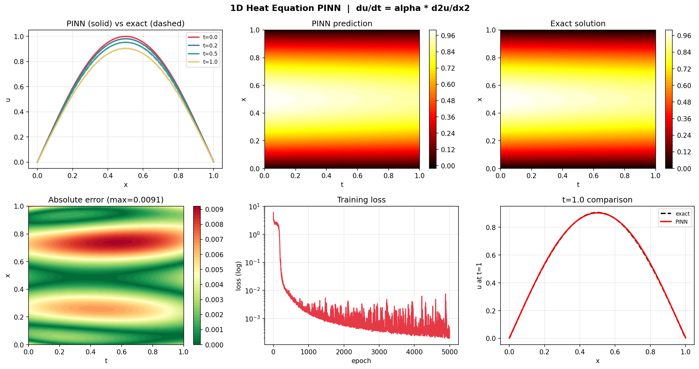

# Physics-Informed Neural Networks (PINNs)

Solving real-world PDEs with neural networks that learn from physics equations — not just data.



---

## What this is

Most neural networks need thousands of labeled examples to learn. PINNs are different — they learn by enforcing **physics equations** (PDEs) directly inside the loss function. The result: accurate predictions from boundary and initial conditions alone, with zero labeled training data.

This project solves three classic PDEs of increasing difficulty:

| File | Equation | Domain | Difficulty |
|---|---|---|---|
| `day2_1d_heat_pinn.py` | `du/dt = α ∂²u/∂x²` | 1D + time | Baseline |
| `day3_2d_heat_pinn.py` | `du/dt = α (∂²u/∂x² + ∂²u/∂y²)` | 2D + time | Medium |
| `day4_burgers_pinn.py` | `du/dt + u∂u/∂x = ν ∂²u/∂x²` | 1D + time | Hard (nonlinear) |

---

## How it works

A standard neural network minimizes only data loss. A PINN minimizes:

```
Total Loss = PDE Residual Loss + Boundary Condition Loss + Initial Condition Loss
```

The PDE residual is computed using `torch.autograd.grad` — PyTorch automatically differentiates the network output with respect to its inputs (x, t), giving us ∂u/∂t, ∂u/∂x, ∂²u/∂x² on demand. If the network satisfies the PDE, the residual is zero.

```python
# core mechanic - gradient of output w.r.t. input (not weights)
u = model(x, t)
du_dt   = torch.autograd.grad(u, t, torch.ones_like(u), create_graph=True)[0]
du_dx   = torch.autograd.grad(u, x, torch.ones_like(u), create_graph=True)[0]
d2u_dx2 = torch.autograd.grad(du_dx, x, torch.ones_like(du_dx), create_graph=True)[0]

residual = du_dt - alpha * d2u_dx2  # heat equation — push this to 0
```

---

## Results

### Day 2 — 1D Heat Equation
- **0.617% relative L2 error** vs analytical solution `u(x,t) = exp(-α π² t) sin(πx)`
- Max absolute error: 0.009
- 5000 epochs, Adam lr=1e-3, zero training data

### Day 3 — 2D Heat Equation
- Extended to `[x, y, t]` input — 3D input space
- Enforces zero BC on all 4 walls simultaneously
- Captures spatial decay in both dimensions
- Relative L2 error vs analytical solution: **TODO — run `day3_2d_heat_pinn.py` and paste the numbers**

### Day 4 — Burgers' Equation
- Nonlinear PDE — the `u ∂u/∂x` term creates a **shock wave** near x=0
- This is the exact benchmark from the original PINN paper (Raissi et al. 2019)
- Scored against the exact Cole-Hopf solution (`utils/burgers_reference.py`), compared with the same network trained on IC/BC data only (no physics)
- Relative L2 error: **TODO — run `day4_burgers_pinn.py` and paste the numbers** (PINN vs no-physics baseline)

---

## Setup

```bash
git clone https://github.com/AnaaOps/PINN-Project
cd PINN-Project
pip install -r requirements.txt
```

Run any file directly:

```bash
python day2_1d_heat_pinn.py   # ~2 min on CPU
python day3_2d_heat_pinn.py   # ~5 min on CPU
python day4_burgers_pinn.py   # ~6 min on CPU
```

Or use the Colab notebooks in `notebooks/` — GPU recommended for Day 3+.

---

## File structure

```
PINN-Project/
├── day1_autograd_basics.py      # core mechanic: grad of output w.r.t. input
├── day2_1d_heat_pinn.py         # 1D heat equation PINN, validated vs exact solution
├── day3_2d_heat_pinn.py         # 2D heat equation PINN, Laplacian in 2 dimensions
├── day4_burgers_pinn.py         # Burgers equation, nonlinear, shock formation
├── utils/
│   └── burgers_reference.py     # exact Burgers solution (Cole-Hopf), used to score day4
├── notebooks/                   # 01-04, step-by-step Colab versions of each day
├── outputs/                     # saved plots from each run
├── requirements.txt
└── README.md
```

---

## Key concepts for interviews

| Concept | One line |
|---|---|
| Why `requires_grad=True` on input? | Need ∂u/∂x and ∂u/∂t — gradients of output w.r.t. input, not just weights |
| Why `create_graph=True`? | Keeps graph alive for second differentiation (∂²u/∂x²) |
| Why Tanh not ReLU? | ReLU's 2nd derivative is 0 — breaks the physics loss completely |
| Why IC/BC weighted 10×? | PDE has infinite solutions; IC/BC pick the physically correct one |
| What is a collocation point? | Random interior point where PDE residual is evaluated each epoch |
| Why Burgers is harder? | Nonlinear `u ∂u/∂x` term creates shocks — standard NNs can't reproduce them |

---

## Stack

Python · PyTorch · NumPy · Matplotlib

Concepts: autograd, PDE residuals, collocation sampling, scientific computing, numerical methods
