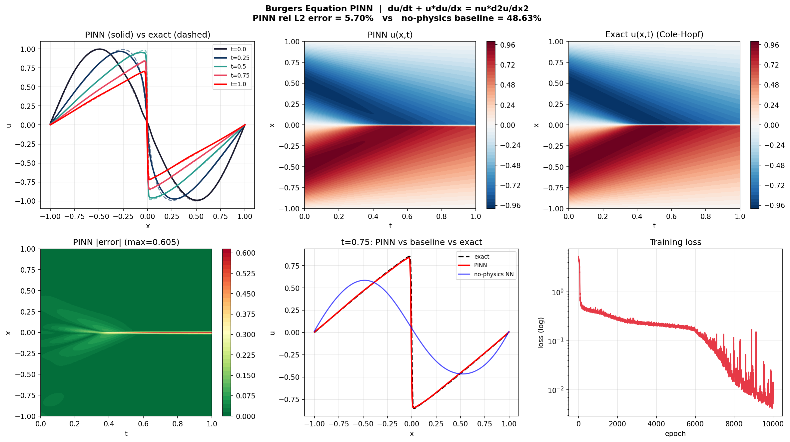

# PINN-Project: physics-informed learning for heat and Burgers equations

I built this to learn how neural networks can solve PDEs, starting from autograd basics and ending with operator learning. Everything runs on a laptop CPU in PyTorch.

The project has three parts:

1. **PINNs** for the 1D heat, 2D heat and Burgers equations
2. **L-BFGS fine-tuning**, which fixed most of the error on Burgers
3. **FNO and PINO** (Fourier neural operators), compared on how few labeled samples they need

## Results

| Problem | Method | Relative L2 error vs exact |
|---|---|---|
| 1D heat | PINN | TODO (paste exact value from `1d_heat_pinn.py`) |
| 2D heat | PINN | 0.90% at t=0, 1.12% at t=1 (8000 epochs) |
| Burgers | PINN, Adam 10k epochs | 5.70% (max abs error 0.605) |
| Burgers | Same network, no physics (IC/BC data only) | 48.63% |
| Burgers | Adam 5k epochs only | 32.23% (seed 42) |
| Burgers | Adam 5k + L-BFGS | 0.49% (seed 42, max abs error 0.055) |

The exact solutions are the analytical solution for the heat equations and the Cole-Hopf solution for Burgers (`utils/burgers_reference.py`).



### L-BFGS fine-tuning (Burgers)

Adam alone stalls at about 32% error. Switching to L-BFGS on a fixed set of collocation points brought it down to 0.49% on seed 42.

| Seed | Adam only | Adam + L-BFGS |
|---|---|---|
| 42 | 32.23% | 0.49% |
| 1 | TODO | TODO |
| 2 | TODO | TODO |

I also tried putting half the collocation points near the shock (`--refine`). In my run this made things worse (3.36% vs 0.49%, seed 42). I only ran it once, so I can't say why.

### FNO vs PINO (Burgers, periodic, nu = 0.01)

Both models learn the map from an initial condition u(x,0) to the solution u(x,1), trained on 1000 random initial conditions with solver data from a pseudo-spectral solver (`FNO_dataset.py`). The PINO adds the PDE residual as an extra loss, using all 1000 initial conditions without needing labels. I varied how many of them have labels.

| Labeled samples | FNO | PINO (weight 0.1, filtered) |
|---|---|---|
| 1000 | 4.38% | 11.29% (weight 0.1), 6.90% (weight 0.001) |
| 50 | 49.84%, 49.87%, 53.72% (mean 51.1%) | 39.76%, 36.99%, 37.57% (mean 38.1%) |

With only 50 labels the physics loss lowers the error by about 13 points on average (3 seeds each). With all 1000 labels it never helped: 11.29% at weight 0.1, 7.54% at weight 0.01 (without the filter) and 6.90% at weight 0.001, against 4.38% for the plain FNO. The error gets closer to the FNO as the weight shrinks, which suggests the physics term only gets in the way when there is plenty of labeled data. Those 1000-label runs are single seeds, and they mix filtered and unfiltered settings.

## What I learned and what went wrong

- **Boundary sampler bug.** In the 2D heat script, boundary points were sampled three times per epoch with mismatched times. I fixed it to sample once.
- **The shock is hard.** In Burgers the error concentrates in a thin line at x=0 and grows with time (3.6% at t=0.25, 11.4% at t=1.0).
- **No-physics baseline.** The same network trained only on initial and boundary data fits them (loss 0.001) but has 48.6% error inside the domain, which is the point of adding the PDE loss.
- **Filtering the physics loss.** The spectral derivative multiplies each Fourier mode by k^2, so I guessed that high-frequency noise in the network output was inflating the residual, and added the same 2/3 low-pass filter the solver uses. On seed 0 at weight 0.1 it lowered the 50-label error from 42.46% to 39.76%. That is one seed and a small gain, so I can't say the filter matters or that my explanation is right.
- **Physics loss hurts with plenty of data.** At 1000 labels the PINO did worse than the FNO for every weight I tried (0.1, 0.01, 0.001), and the filter didn't fix it. At weight 0.1 the data fit got worse (train data loss 0.10 vs 0.026), so I think the physics term competes with the data term.
- **FNO viscosity.** My first dataset used nu = 0.1, but everything had decayed to nearly zero by t=1, which made the problem trivial. I switched to nu = 0.01.

## Limitations

- Seeds: 3 seeds for FNO/PINO at 50 labels and for L-BFGS; 1 seed for FNO/PINO at 1000 labels and everything else. These are small samples, and all runs use the same 200 test samples.
- I picked the PINO weight (0.1) by looking at test error, so that number is slightly optimistic.
- PINO is slower per epoch than the FNO because of the extra forward passes for the time derivative.
- Even with the physics loss, the PINO residual stays around 1, so it doesn't fully satisfy the PDE.

## Running it

```bash
pip install -r requirements.txt
python 1d_heat_pinn.py
python 2d_heat_pinn.py
python burgers_pinn.py
python lbfgs_finetune.py --seed 42
python FNO_dataset.py
python FNO_train.py --n-labeled 50
python FNO_train.py --n-labeled 50 --physics-weight 0.1 --dealias
```

Results are saved to `outputs/` (FNO/PINO runs also append to `outputs/fno_results.csv`).

## Files

```
autograd_basics.py   gradients of network outputs w.r.t. inputs
1d_heat_pinn.py      1D heat equation PINN
2d_heat_pinn.py      2D heat equation PINN
burgers_pinn.py      Burgers PINN + no-physics baseline
lbfgs_finetune.py    Adam -> L-BFGS for Burgers
FNO_dataset.py       spectral solver + dataset for the FNO
FNO_train.py         FNO and PINO training
utils/               exact Burgers solution (Cole-Hopf)
outputs/             plots and fno_results.csv
```
